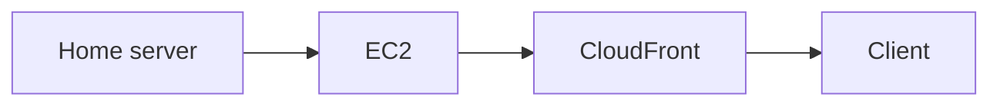

# The TERMINAL

**The TERMINAL** is a free repository of things that would normally make a school very unhappy, like unblocked games, YouTube, and a proxy, all while making it look like you are hacking the mainframe.

I made this because I was bored, and needed something to do.

To run it, simply copy `bootstrap.html` and run it as a file or in a code editor.

## Backend Setup
The TERMINAL connects to a backend server to run most of the flagship programs. This is for functionality, to protect sensitive data, and to ensure total control over services.

This repository already connects to one that I run and maintain. And for most users, this is fine. However, if you want to use your own, either because you want to have total independence, or you just don't trust me with your search history, then please continue reading.

### Machine Requirements
You can run the backend on basically anything, from a dedicated home server like me, to the cloud, and even the PC you are using to read this right now.

> **Using Your Own Everyday Computer?**
> Because the backend relies on Linux tools (`tor`, `xray`, and `node-pty`), **Linux (Ubuntu 22.04/24.04 LTS or Debian 12+)** is strongly recommended. If you are using **Windows**, install **WSL2 (Ubuntu)** with `systemd` enabled. If on **macOS** or Windows and you want clean isolation, run Ubuntu inside a free virtual machine (like VirtualBox or VMware). Keep in mind that the proxy only stays online while your computer is sleeping.

### Dependencies

Before installing The TERMINAL, you will have to get keys for some of the flagship projects that can only be done on the web.

1. **YouTube Data API v3 Key (`YOUTUBE_KEY`):**
   * Go to the [Google Cloud Console](https://console.cloud.google.com/) and create a free project. Create an account if you have not already.
   * Open **APIs & Services → Library**, search for **YouTube Data API v3**, and click **Enable**.
   * Go to **APIs & Services → Credentials → Create Credentials → API key** and save the key.
2. **Google Gemini API Key (`GEMINI_KEY`):**
   * Go to [Google AI Studio](https://aistudio.google.com/), click **Get API key → Create API key**, and save the key.
3. **Admin Credentials (`ADMINS_JSON`):**
   * This isn't really an API key, but whatever. You just need to use your imagination to invent a username and a strong password to lock down `admin`.

Keep the keys somewhere safe, you will have to copy and paste them later.

### Installation

This is where you get to use the Linux kernel (hooray!). If you do not know the basics of using one, you should probably learn how to do that first, or else setting this up will be much harder than necessary. Just go on the Internet and find tutorials for it.

All you need to know is how to use and navigate in `nano`, basic commands (like `cat` and `sudo`), and how to read. This tutorial will try to be as easy to use as possible, however if something looks unfamiliar, you can always search it up.

1. First things first, you'll need to install basic dependencies (`python3`, `make`, `g++`, `nodejs`, `pm2`, and `tor`). Copy and paste the following block (the whole thing) and press Enter.
```bash
sudo apt update
sudo apt install -y curl unzip uuid-runtime openssl tor python3 make g++

# Install Node.js
curl -fsSL https://deb.nodesource.com/setup_lts.x | sudo -E bash -
sudo apt install -y nodejs

# Install PM2
sudo npm install -g pm2

# Prevent the default Tor service from clashing with startup.sh, which starts Tor on port 9050
sudo systemctl disable --now tor
```

2. Install Xray-core and generate a Cloudflare WARP profile. This handles the proxy's encryption.
```bash
# Install Xray-core
sudo bash -c "$(curl -L https://github.com/XTLS/Xray-install/raw/main/install-release.sh)" @ install

# Install wgcf
# Use _linux_arm64 instead of _linux_amd64 if on ARM/Raspberry Pi/t4g on AWS
curl -L -o wgcf https://github.com/ViRb3/wgcf/releases/latest/download/wgcf_2.2.22_linux_amd64
chmod +x wgcf
sudo mv wgcf /usr/local/bin/wgcf

# Generate your WARP WireGuard profile
mkdir -p ~/warp-keys && cd ~/warp-keys
wgcf register    # Accept the terms when prompted
wgcf generate
cat wgcf-profile.conf
```

Keep `wgcf-profile.conf` open. You need its `PrivateKey`, `Address` (IPv4 and IPv6), `PublicKey`, and `Endpoint` in the fourth step. You can always run `cat wgcf-profile.conf` if you lose it in the ensuing mess.

3. Generate keys for the VLESS-REALITY, VMess, and Shadowsocks tunnels.

| Command | What It Creates | Where to Paste in `config.json` |
| :--- | :--- | :--- |
| `uuidgen` *(run twice for 2 IDs)* | Random UUIDs | `"id"` in `srv-vless-reality` & `vless-reality-out` (UUID 1), and `srv-vmess-ws` & `vmess-ws-out` (UUID 2) |
| `xray x25519` | `PrivateKey` & `PublicKey` | `PrivateKey` → `srv-vless-reality` (`"privateKey"`)<br>`PublicKey` → `vless-reality-out` (`"publicKey"`) |
| `openssl rand -hex 8` | 16-character `shortId` | `srv-vless-reality` (`"shortIds": ["..."]`) and `vless-reality-out` (`"shortId"`) |
| `openssl rand -base64 32` | 32-byte Shadowsocks password | `srv-shadowsocks` (`"password"`) and `shadowsocks-out` (`"password"`) |

4. Configure and start up Xray-core by opening `/usr/local/etc/xray/config.json` (`sudo nano /usr/local/etc/xray/config.json`) and paste the following configuration into the nano editor.

Replace every `PASTE_...` placeholder with the values you have from Steps 2 and 3 (`"reserved": [0, 0, 0]` is the standard default for `wgcf`).

Use **Ctrl + Shift + V** to paste, the arrow keys to navigate (you can't use your mouse to relocate the cursor), and press **Ctrl + O + Enter** to save then **Ctrl + X** to exit.
```json
{
  "log": { "loglevel": "warning" },
  "dns": { "servers": ["1.1.1.1", "8.8.8.8", "localhost"] },
  "inbounds": [
    { "tag": "in-direct", "port": 10800, "listen": "127.0.0.1", "protocol": "socks", "settings": { "auth": "noauth", "udp": true } },
    { "tag": "in-blackhole", "port": 10801, "listen": "127.0.0.1", "protocol": "socks", "settings": { "auth": "noauth" } },
    { "tag": "in-warp", "port": 10808, "listen": "127.0.0.1", "protocol": "socks", "settings": { "auth": "noauth", "udp": true } },
    { "tag": "in-vless-reality", "port": 10811, "listen": "127.0.0.1", "protocol": "socks", "settings": { "auth": "noauth", "udp": true } },
    { "tag": "in-vmess-ws", "port": 10813, "listen": "127.0.0.1", "protocol": "socks", "settings": { "auth": "noauth", "udp": true } },
    { "tag": "in-shadowsocks", "port": 10815, "listen": "127.0.0.1", "protocol": "socks", "settings": { "auth": "noauth", "udp": true } },
    {
      "tag": "srv-vless-reality",
      "port": 20811,
      "listen": "127.0.0.1",
      "protocol": "vless",
      "settings": { "clients": [{ "id": "PASTE_UUID_1" }], "decryption": "none" },
      "streamSettings": {
        "network": "tcp",
        "security": "reality",
        "realitySettings": {
          "show": false,
          "dest": "www.google.com:443",
          "xver": 0,
          "serverNames": ["www.google.com"],
          "privateKey": "PASTE_X25519_PRIVATE_KEY",
          "shortIds": ["PASTE_SHORT_ID"]
        }
      }
    },
    {
      "tag": "srv-vmess-ws",
      "port": 20813,
      "listen": "127.0.0.1",
      "protocol": "vmess",
      "settings": { "clients": [{ "id": "PASTE_UUID_2", "alterId": 0 }] },
      "streamSettings": { "network": "ws", "wsSettings": { "path": "/wisp-vmess" } }
    },
    {
      "tag": "srv-shadowsocks",
      "port": 20815,
      "listen": "127.0.0.1",
      "protocol": "shadowsocks",
      "settings": { "method": "2022-blake3-aes-256-gcm", "password": "PASTE_BASE64_32_PASSWORD", "network": "tcp,udp" }
    }
  ],
  "outbounds": [
    {
      "tag": "warp-out",
      "protocol": "wireguard",
      "settings": {
        "secretKey": "PASTE_WGCF_PRIVATE_KEY",
        "address": ["PASTE_WGCF_IPV4/32", "PASTE_WGCF_IPV6/128"],
        "peers": [{ "publicKey": "PASTE_WGCF_PUBLIC_KEY", "endpoint": "PASTE_WGCF_ENDPOINT", "reserved": [0, 0, 0] }],
        "noKernelTun": true
      }
    },
    { "tag": "direct", "protocol": "freedom", "settings": { "domainStrategy": "UseIP" } },
    { "tag": "blackhole-out", "protocol": "blackhole", "settings": { "response": { "type": "http" } } },
    {
      "tag": "vless-reality-out",
      "protocol": "vless",
      "settings": { "vnext": [{ "address": "127.0.0.1", "port": 20811, "users": [{ "id": "PASTE_UUID_1", "encryption": "none" }] }] },
      "streamSettings": {
        "network": "tcp",
        "security": "reality",
        "realitySettings": { "show": false, "fingerprint": "chrome", "serverName": "www.yahoo.com", "publicKey": "PASTE_X25519_PUBLIC_KEY", "shortId": "PASTE_SHORT_ID" }
      }
    },
    {
      "tag": "vmess-ws-out",
      "protocol": "vmess",
      "settings": { "vnext": [{ "address": "127.0.0.1", "port": 20813, "users": [{ "id": "PASTE_UUID_2", "alterId": 0, "security": "auto" }] }] },
      "streamSettings": { "network": "ws", "wsSettings": { "path": "/wisp-vmess" } }
    },
    {
      "tag": "shadowsocks-out",
      "protocol": "shadowsocks",
      "settings": { "servers": [{ "address": "127.0.0.1", "port": 20815, "method": "2022-blake3-aes-256-gcm", "password": "PASTE_BASE64_32_PASSWORD" }] }
    }
  ],
  "routing": {
    "domainStrategy": "IPIfNonMatch",
    "rules": [
      { "type": "field", "outboundTag": "direct", "ip": ["geoip:private", "1.1.1.1", "8.8.8.8"] },
      { "type": "field", "outboundTag": "direct", "port": "53" },
      { "type": "field", "inboundTag": ["in-direct"], "outboundTag": "direct" },
      { "type": "field", "inboundTag": ["in-blackhole"], "outboundTag": "blackhole-out" },
      { "type": "field", "inboundTag": ["in-warp"], "outboundTag": "warp-out" },
      { "type": "field", "inboundTag": ["in-vless-reality"], "outboundTag": "vless-reality-out" },
      { "type": "field", "inboundTag": ["in-vmess-ws"], "outboundTag": "vmess-ws-out" },
      { "type": "field", "inboundTag": ["in-shadowsocks"], "outboundTag": "shadowsocks-out" },
      { "type": "field", "inboundTag": ["srv-vless-reality", "srv-vmess-ws", "srv-shadowsocks"], "outboundTag": "warp-out" }
    ]
  }
}
```

Then, start Xray-core (`sudo systemctl enable --now xray`).

If you want to check if it works, return `sudo systemctl status xray`. If it returns `active (running)` somewhere in green text, then it is functioning. If it fails or shows `inactive (dead)`, return `sudo journalctl -u xray -n 50 --no-pager` to troubleshoot. Again, you can search it up to fix.

5. Now you can install The TERMINAL! Navigate to `/backend` and install TERMINAL-specific dependencies.
```bash
git clone https://github.com/HoujenHuang/TERMINAL.git
cd TERMINAL/backend
npm install
```

Create `.env` (`nano .env`) and add the API keys you've saved.
```env
PORT=8080
YOUTUBE_KEY=YOUR_YOUTUBE_DATA_API_KEY
GEMINI_KEY=YOUR_GEMINI_API_KEY

ADMINS_JSON: '{
  "yourname@terminal": {
    "password": "A really strong password"
  }
}'
```

6. Finally, launch using PM2.
```bash
chmod +x startup.sh
pm2 start ./startup.sh --name terminal
pm2 save
pm2 startup   # Copy and run the sudo command that PM2 prints out
```

Now that it is set up, you will need to open it up to the Internet.

### EC2-CloudFront Gateway Setup

It is recommended that you deploy using EC2 and CloudFront from Amazon Web Services as a gateway, where your home machine connects to EC2 (a virtual machine which acts as a middleman), which connects to CloudFront (A CDN that gives you a free URL).



This is for multiple reasons:

- **Hides your home IP address**: Anyone using the proxy only ever sees CloudFront's servers. Even CloudFront only talks to EC2. Your home internet IP is never exposed to the public internet or DDoS attacks.
- **No home router port forwarding required**: Your home server reaches out to EC2 through an encrypted WireGuard tunnel, so you never have to touch your home router. It works even if your ISP blocks ports or uses CGNAT.
- **Free HTTPS without buying a domain**: Browsers require secure `wss://` WebSockets for proxies. CloudFront provides a free `cloudfront.net` HTTPS domain automatically. Plus, you can always swap a new URL and virtual machine at will if it ever gets blocked.
- **Keeps AWS costs minimal**: Your home machine does the heavy CPU/RAM work (Node.js, Tor, Xray, WebTTY), while EC2 only needs a tiny `t3.micro` or `t4g.micro` instance relaying traffic.
- **Unblockable by schools**: Many educational websites require AWS for everyday backend operations, including EC2 and CloudFront, meaning that blocking the domain will break them.

1. In AWS Console, **EC2 → Launch Instance**, pick **Ubuntu Server 22.04 or 24.04 LTS** on a **`t3.micro`** or **`t4g.micro`** (1 GiB RAM, 8 GB storage).
2. Under **Firewall (Security Groups)**, allow:
   * **SSH (TCP `22`)** — from **My IP** (for setup)
   * **HTTP (TCP `80`)** — from **Anywhere** (for CloudFront)
   * **Custom UDP (`51820`)** — from **Anywhere** (for WireGuard)
3. Note the EC2 instance's **Public IPv4 address**.
4. Install WireGuard on **both** machines:
```bash
# Run on EC2 AND on your home machine
sudo apt update && sudo apt install -y wireguard
wg genkey | sudo tee /etc/wireguard/privatekey | wg pubkey | sudo tee /etc/wireguard/publickey
```

**On EC2**, create `/etc/wireguard/wg0.conf` (`sudo nano /etc/wireguard/wg0.conf`).
```ini
[Interface]
Address = 10.0.0.1/24
ListenPort = 51820
PrivateKey = <PASTE_EC2_PRIVATE_KEY>

[Peer]
PublicKey = <PASTE_HOME_SERVER_PUBLIC_KEY>
AllowedIPs = 10.0.0.2/32
```

**On your Home Server/PC**, create `/etc/wireguard/wg0.conf` (`sudo nano /etc/wireguard/wg0.conf`).
```ini
[Interface]
Address = 10.0.0.2/24
PrivateKey = <PASTE_HOME_SERVER_PRIVATE_KEY>

[Peer]
PublicKey = <PASTE_EC2_PUBLIC_KEY>
Endpoint = <PASTE_EC2_PUBLIC_IP>:51820
AllowedIPs = 10.0.0.1/32
PersistentKeepalive = 25
```

Start WireGuard on **both** machines:
```bash
sudo systemctl enable --now wg-quick@wg0
```
Test from EC2 by running `ping -c 3 10.0.0.2`. If you get replies, your encrypted tunnel is live.

5. Set up NGINX on EC2 (`sudo apt install -y nginx && sudo nano /etc/nginx/sites-available/default`) and paste this configuration in.
```bash
server {
    listen 80 default_server;
    listen [::]:80 default_server;
    server_name _;

    if ($http_user_agent ~* (censys|shodan|masscan|zgrab|nmap|nikto)) {
        return 444;
    }

    location /wisp/ {
        proxy_pass http://10.0.0.2:8080/wisp/;
        proxy_http_version 1.1;
        proxy_set_header Upgrade $http_upgrade;
        proxy_set_header Connection "upgrade";
        proxy_set_header Host $host;
        proxy_set_header X-Real-IP $remote_addr;
        proxy_set_header X-Forwarded-For $proxy_add_x_forwarded_for;
        proxy_set_header X-Forwarded-Proto $scheme;
        proxy_buffering off;
        proxy_read_timeout 86400s;
        proxy_send_timeout 86400s;
    }

    location /api/admin/tty {
        proxy_pass http://10.0.0.2:8080;
        proxy_http_version 1.1;
        proxy_set_header Upgrade $http_upgrade;
        proxy_set_header Connection "upgrade";
        proxy_set_header Host $host;
        proxy_set_header X-Real-IP $remote_addr;
        proxy_set_header X-Forwarded-For $proxy_add_x_forwarded_for;
        proxy_read_timeout 86400s;
        proxy_send_timeout 86400s;
        proxy_buffering off;
        access_log off;
    }

    location / {
        proxy_pass http://10.0.0.2:8080/;
        proxy_http_version 1.1;
        proxy_set_header Host $host;
        proxy_set_header X-Real-IP $remote_addr;
        proxy_set_header X-Forwarded-For $proxy_add_x_forwarded_for;
        proxy_set_header X-Forwarded-Proto $scheme;
    }
}
```

Test and reload NGINX (`sudo nginx -t && sudo systemctl reload nginx`). If it returns the following, then it is alive.
```
nginx: the configuration file /etc/nginx/nginx.conf syntax is ok
nginx: configuration file /etc/nginx/nginx.conf test is successful
```

6. Put CloudFront in Front of EC2. Open **AWS CloudFront → Create Distribution**. Set **Origin domain** to your EC2 instance's **Public IPv4 DNS** (e.g., `ec2-xx-xx-xx-xx.compute-1.amazonaws.com`), and set Protocol to **HTTP only** (port `80`).

Under **Default cache behavior**:
   * **Viewer protocol policy:** `Redirect HTTP to HTTPS`
   * **Allowed HTTP methods:** `GET, HEAD, OPTIONS, PUT, POST, PATCH, DELETE`
   * **Cache policy:** `CachingDisabled`
   * **Origin request policy:** `AllViewer`

7. Because The TERMINAL's code is pretty long, it uses JSDelivr to import the scripts into the browser. Fork this repository, and edit `frontend/config.json` to have your CloudFront URL in it.
```json
{
  "API_GATEWAY": "yourdomain.cloudfront.net"
}
```

That's all! To read requests going to your server, run `cat requests.jsonl`.
